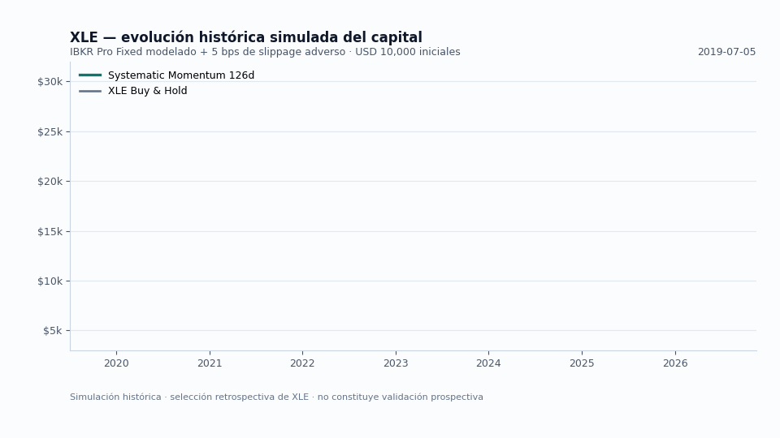

# 02 — Factor Momentum

**¿Cuánto del momentum de un activo puede atribuirse a factores sistemáticos?**

Esta línea estudia si parte del momentum observado en ETFs puede entenderse mediante exposiciones dinámicas a proxies económicos observables. Es investigación histórica y exploratoria: no presenta alpha validado ni una estrategia operable.



*Evolución de USD 10,000 en dos carteras históricas simuladas, con comisiones IBKR Pro Fixed modeladas y 5 bps de slippage adverso. XLE fue seleccionada retrospectivamente; los resultados no constituyen validación prospectiva.*

[Ver gráfica estática](assets/xle_systematic_vs_buyhold_fixed_5bps.png)

## Alcance científico

El universo inicial utiliza siete ETFs líquidos como proxies económicos observables: SPY, QQQ, IWM, IWD, IWF, XLE y XLF. No se presentan como factores académicos puros ni como una caracterización completa de las exposiciones de cada activo.

La investigación se concentra en QQQ, XLE y XLF como activos objetivo. XLE se examina con mayor detalle por el contraste histórico observado entre la señal sistemática y sus benchmarks, sin confundir esa selección retrospectiva con evidencia independiente.

## Metodología factorial

El modelo descriptivo parte de:

$ R_{i,t} = \alpha_i + \beta_{i,MKT} MKT_t + \beta_{i,SIZE} SIZE_t + \beta_{i,GV} GV_t + \epsilon_{i,t} $

- $MKT$ se representa con SPY.
- $SIZE$ se representa con IWM menos SPY.
- $GV$ se representa con IWF menos IWD.
- Las exposiciones se estiman con rolling OLS de 252 sesiones e intercepto.
- Para atribuir el retorno de $t$, los coeficientes sólo incorporan información hasta $t-1$.
- El momentum total, de mercado y sistemático utiliza un horizonte congelado de 126 sesiones; las señales son long/cash, sin apalancamiento.

La atribución usa los retornos contemporáneos de los factores observados al cierre de $t$. Por ello evalúa explicación fuera de muestra del retorno realizado, no una predicción del retorno disponible antes de iniciar la sesión.

## Hallazgos principales

En la atribución fuera de muestra, el modelo completo aporta una explicación mayor que el mercado aislado, pero esa contribución no es uniforme entre activos ni subperiodos. QQQ muestra una atribución alta y relativamente estable; XLF es intermedio; XLE conserva una proporción residual más amplia y un deterioro visible en 2023–2026.

El experimento de señales no muestra dominancia general de Systematic Momentum frente a TSMOM clásico o Market Momentum: el resultado cambia entre QQQ, XLE y XLF. La utilidad de la descomposición debe leerse como una hipótesis económica condicionada al diseño fijado, no como una búsqueda de parámetros óptimos.

## Candidata exploratoria: XLE Systematic Momentum 126d

XLE fue seleccionada después de observar el mismo historial que se resume aquí. La candidata congelada combina momentum sistemático de 126 sesiones, betas rolling OLS de 252 sesiones y los factores MKT, SIZE y GV. Mantiene una política long/cash, sin posiciones cortas ni apalancamiento; las decisiones se forman al cierre de $t$.

La simulación de ejecución usa USD 10,000 iniciales, acciones enteras, efectivo no negativo, órdenes preparadas tras el cierre y fills simulados en la apertura siguiente. En el escenario **IBKR Pro Fixed modelado + 5 bps de slippage adverso**, los resultados históricos simulados fueron:

- Capital final de Systematic Momentum: **USD 28,028.02**.
- CAGR: **15.046%**, frente a **12.318%** de Buy & Hold.
- Máximo drawdown: **−27.805%**, frente a **−57.981%** de Buy & Hold.
- **63 operaciones** durante la ventana de ejecución.

Son resultados históricos simulados, no PnL real de IBKR. Las comisiones, el slippage y la contabilidad de dividendos/splits son supuestos de simulación; no incluyen bid/ask histórico, latencia, impacto de mercado ni confirmación prospectiva.

## Notebooks y artículos

| Notebook (título y enlace relativo) | Artículo correspondiente |
| --- | --- |
| [01 — Fundamentos de momentum factorial](notebooks/01_factor_momentum_foundations.ipynb) | Artículo 01 — «¿Cuánto del momentum de un activo puede atribuirse a factores sistemáticos?» — Pendiente |
| [02 — Prueba de señales de momentum factorial](notebooks/02_factor_momentum_signal_test.ipynb) | Artículo 01 — «¿Cuánto del momentum de un activo puede atribuirse a factores sistemáticos?» — Pendiente |
| [01 — XLE: viabilidad de ejecución](strategy_candidates/xle_systematic_momentum/notebooks/01_execution_feasibility.ipynb) | Artículo 02 — «De Factor Momentum a XLE: señal long/cash, ejecución y límites económicos» — Pendiente |
| [02 — XLE: revisión previa a paper trading](strategy_candidates/xle_systematic_momentum/notebooks/02_pre_paper_review.ipynb) | Artículo 02 — «De Factor Momentum a XLE: señal long/cash, ejecución y límites económicos» — Pendiente |

## Reproducibilidad en Google Colab

La versión pública reproducible es [factor-momentum-colab-v1.1](https://github.com/ADRIANVM117/quant-research-notes/tree/factor-momentum-colab-v1.1). Cada notebook prepara dependencias compatibles, descarga los siete Parquet Gold desde una revisión inmutable y verifica sus hashes antes de calcular.

- [Abrir Fundamentos en Colab](https://colab.research.google.com/github/ADRIANVM117/quant-research-notes/blob/factor-momentum-colab-v1.1/Momentum_systematic_strategies/02_factor_momentum/notebooks/01_factor_momentum_foundations.ipynb)
- [Abrir Prueba de señales en Colab](https://colab.research.google.com/github/ADRIANVM117/quant-research-notes/blob/factor-momentum-colab-v1.1/Momentum_systematic_strategies/02_factor_momentum/notebooks/02_factor_momentum_signal_test.ipynb)
- [Abrir Viabilidad de ejecución en Colab](https://colab.research.google.com/github/ADRIANVM117/quant-research-notes/blob/factor-momentum-colab-v1.1/Momentum_systematic_strategies/02_factor_momentum/strategy_candidates/xle_systematic_momentum/notebooks/01_execution_feasibility.ipynb)
- [Abrir Revisión previa a paper trading en Colab](https://colab.research.google.com/github/ADRIANVM117/quant-research-notes/blob/factor-momentum-colab-v1.1/Momentum_systematic_strategies/02_factor_momentum/strategy_candidates/xle_systematic_momentum/notebooks/02_pre_paper_review.ipynb)

No se necesitan claves de API, Google Drive, archivos locales ni ejecutar notebooks anteriores. El bootstrap de las notebooks XLE recupera y valida, mediante SHA-256, las referencias analíticas requeridas.

La gráfica de este README se puede regenerar desde un entorno limpio validado con Python 3.13.2. Desde la raíz del repositorio, en Linux/macOS:

```bash
python -m venv .venv-animation
.venv-animation/bin/python -m pip install --upgrade pip
.venv-animation/bin/python -m pip install -r Momentum_systematic_strategies/02_factor_momentum/scripts/requirements-animation.txt
.venv-animation/bin/python Momentum_systematic_strategies/02_factor_momentum/scripts/generate_xle_execution_animation.py
```

En Windows PowerShell:

```powershell
py -3.13 -m venv .venv-animation
.\.venv-animation\Scripts\python.exe -m pip install --upgrade pip
.\.venv-animation\Scripts\python.exe -m pip install -r Momentum_systematic_strategies/02_factor_momentum/scripts/requirements-animation.txt
.\.venv-animation\Scripts\python.exe Momentum_systematic_strategies/02_factor_momentum/scripts/generate_xle_execution_animation.py
```

El script extrae directamente el ledger de la notebook de ejecución, valida sus 1,853 sesiones y no reconstruye ni modifica la simulación. Genera el GIF y el PNG con los Parquet Gold auditados incluidos en el repositorio.

## Limitaciones

- La selección de XLE y la comparación de alternativas usan el mismo historial; no constituyen validación prospectiva independiente.
- Los ETFs son proxies económicos observables, no factores académicos puros ni un modelo exhaustivo de riesgo.
- La atribución factorial contemporánea no equivale a una previsión completa del retorno antes de la sesión.
- La simulación de ejecución no mide spreads bid/ask históricos, latencia, impacto de mercado, disponibilidad de liquidez ni el PnL de una cuenta IBKR real.
- Antes de cualquier evaluación prospectiva se requiere mantener una especificación congelada y registrar observaciones no utilizadas en la selección de XLE.

## Antecedente TSMOM

`01_tsmom` construyó el baseline de momentum temporal: pregunta si un activo sube o baja respecto a su propia historia. Esta línea lo complementa preguntando cuánto de ese movimiento puede relacionarse con proxies sistemáticos, sin reemplazarlo.
