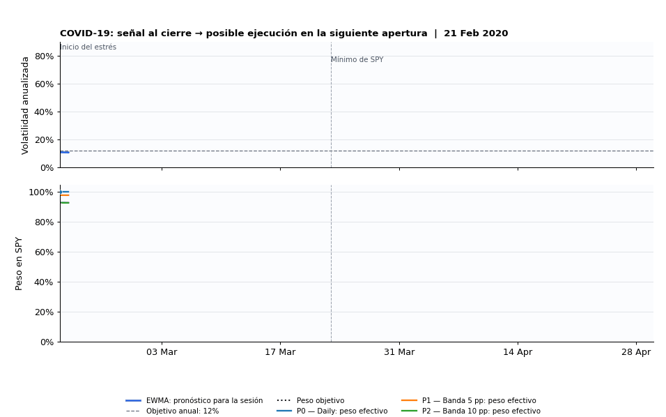
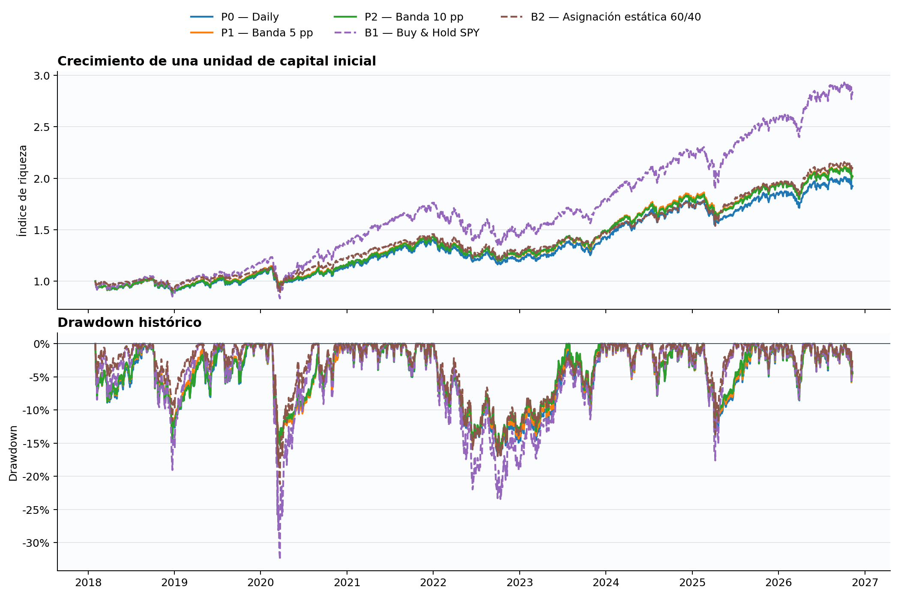

# Volatility Targeting — Del pronóstico de riesgo a las decisiones de inversión

*Investigación cuantitativa reproducible sobre estimación de volatilidad, rebalanceo sistemático y evaluación económica con datos históricos de SPY (2018–2026).*

> ¿Pueden las bandas de tolerancia reducir los costos de implementar una estrategia de volatilidad objetivo sin deteriorar significativamente el control del riesgo?

La investigación fija EWMA con λ = 0.94, volatilidad objetivo anualizada de 12% y exposición máxima de 1×. La señal se calcula al cierre y la posible orden se ejecuta en la apertura de la siguiente sesión.

## Resultado central

| Política | Operaciones | Comisiones e IVA (USD) | MAE frente al 12% (pp) | CAGR |
|---|---:|---:|---:|---:|
| P0 — Rebalanceo diario | 1,547 | 1,278.52 | 2.781 | 7.74% |
| P1 — Banda de 5 pp | 263 | 263.00 | 2.857 | 8.36% |
| P2 — Banda de 10 pp | 115 | 115.00 | 3.083 | 8.34% |

P1 redujo aproximadamente 83% las operaciones y 79% las comisiones frente a P0, con un incremento de 0.077 pp en el MAE de seguimiento del objetivo. Su diferencial histórico de crecimiento logarítmico anualizado fue +0.573 pp frente a P0, con IC bootstrap de 95% [0.275, 0.874].

El resultado es exploratorio: los intervalos no son una confirmación independiente fuera de muestra y no se definió previamente un margen formal de no inferioridad del riesgo.

## Del pronóstico a la exposición

El episodio COVID-19 ilustra la cadena causal completa: EWMA incorpora el retorno observado al cierre, emite el pronóstico para la sesión siguiente y las políticas operan únicamente en esa apertura. Los marcadores muestran las operaciones efectivamente ejecutadas.

## Crecimiento y riesgo histórico

Las cinco curvas usan el mismo calendario y una base de capital inicial común. Las líneas continuas son las políticas dinámicas; las discontinuas son benchmarks. La figura no implica que el mayor CAGR sea necesariamente la mejor decisión, porque las exposiciones y riesgos no son idénticos.

Como referencia contextual, Buy & Hold SPY registró CAGR de 12.58%, volatilidad realizada de 18.11% y drawdown máximo de −32.57%. No es una comparación equivalente con las políticas dinámicas: mantiene una exposición estructuralmente distinta.

## Notebooks y publicaciones

| Notebook | Google Colab | Publicación |
|---|---|---|
| [01 — Pronóstico EWMA](01_volatility_targeting.ipynb) | [Abrir en Colab](https://colab.research.google.com/github/ADRIANVM117/quant-research-notes/blob/main/volatility_target/01_rebalancing_policies/01_volatility_targeting.ipynb) | [Artículo 01](https://adrianvm117.github.io/en/research/notes/01_ewma_volatility_risk.html) |
| [02 — Políticas de rebalanceo](02_rebalancing_policies.ipynb) | [Abrir en Colab](https://colab.research.google.com/github/ADRIANVM117/quant-research-notes/blob/main/volatility_target/01_rebalancing_policies/02_rebalancing_policies.ipynb) | [Artículo 02](https://adrianvm117.github.io/en/research/notes/02_rebalancing_policies.html) |
| [03 — Evaluación económica y estadística](03_economic_statistic_evaluation.ipynb) | [Abrir en Colab](https://colab.research.google.com/github/ADRIANVM117/quant-research-notes/blob/main/volatility_target/01_rebalancing_policies/03_economic_statistic_evaluation.ipynb) | **Próximamente** |

## Reproducibilidad

Cada notebook puede ejecutarse de forma independiente en Google Colab con **Run all**. Descarga y valida los insumos necesarios; no requiere credenciales privadas, descargas manuales ni ejecutar notebooks anteriores.

## Estado de investigación

**CANDIDATE_FOR_FURTHER_VALIDATION**

Las bandas son candidatas para validación adicional; este resultado retrospectivo no autoriza operar capital real ni establece desempeño futuro.
